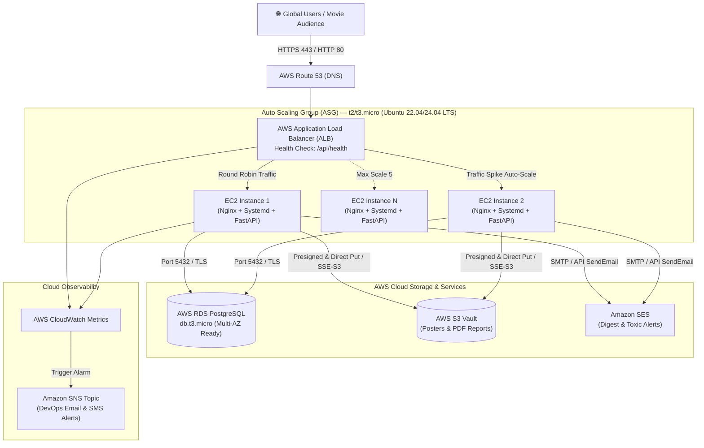

# ☁️ CinemAI: AWS Infrastructure & Cloud DevOps Blueprint

> **Architecture Target:** AWS Free Tier Eligible Direct-Host Infrastructure (No Docker)  
> **Resilience & Scale:** Application Load Balancer (ALB) + Auto Scaling Group (ASG)  
> **Security:** S3 SSE-S3 AES-256 Encrypted Vault + IAM Least Privilege + CloudWatch Alarms  

---

## 🏛️ High-Level Infrastructure Topology



---

## 1. 🚀 EC2 Launch Template & User Data

When scaling during blockbuster movie premiere spikes, new EC2 instances bootstrap automatically using this **EC2 Launch Template**.

### Launch Template Specifications:
- **Template Name:** `cinemai-node-template`
- **AMI:** Ubuntu Server 22.04 LTS (HVM), SSD Volume Type
- **Instance Type:** `t2.micro` or `t3.micro` (Free Tier)
- **IAM Instance Profile:** `CinemAI-EC2-Role` (with S3 & SES permissions detailed below)
- **Security Group Inbound Rules:**
  - `HTTP` (Port 80) $\rightarrow$ Source: `cinemai-alb-sg`
  - `SSH` (Port 22) $\rightarrow$ Source: Admin Bastion IP

### Automated Bootstrap Script (`User Data`):
Paste this into **Advanced Details $\rightarrow$ User Data**:

```bash
#!/usr/bin/env bash
set -euo pipefail

# Log execution
exec > >(tee /var/log/user-data.log|logger -t user-data -s 2>/dev/console) 2>&1

echo "[CinemAI Auto-Scaling Bootstrap] Starting installation..."

# Install git
apt-get update -y
apt-get install -y git

# Clone repository to standard ubuntu home
cd /home/ubuntu
if [ ! -d "/home/ubuntu/cinemai" ]; then
    git clone https://github.com/your-username/cinemai.git /home/ubuntu/cinemai
    chown -R ubuntu:ubuntu /home/ubuntu/cinemai
fi

# Run automated system setup
cd /home/ubuntu/cinemai
chmod +x scripts/setup_ec2.sh
bash scripts/setup_ec2.sh

echo "[CinemAI Auto-Scaling Bootstrap] Host provisioning complete."
```

---

## 2. ⚖️ Application Load Balancer (ALB) & Auto Scaling Group (ASG)

### Target Group Configuration:
- **Target Type:** Instances
- **Protocol / Port:** `HTTP:80`
- **VPC:** Default VPC (or Custom Public Subnets across 2 Availability Zones)
- **Health Check Path:** `/api/health`
- **Health Check Interval:** `15 seconds`
- **Healthy Threshold:** `2 consecutive successes`
- **Unhealthy Threshold:** `3 consecutive failures`
- **Timeout:** `5 seconds`

### Auto Scaling Group Configuration:
- **Group Name:** `cinemai-asg`
- **Launch Template:** `cinemai-node-template`
- **VPC Subnets:** Minimum 2 Subnets (e.g. `us-east-1a`, `us-east-1b`)
- **Capacity:**
  - **Desired Capacity:** `1` (Keeps cost at Free Tier minimum)
  - **Minimum Capacity:** `1`
  - **Maximum Capacity:** `5` (Surges for premiere traffic)
- **Target Tracking Scaling Policy:**
  - **Metric Type:** `ALBRequestCountPerTarget`
  - **Target Value:** `800` requests per minute per target
  - **Scale-Out Cooldown:** `60 seconds`
  - **Scale-In Cooldown:** `300 seconds`

---

## 3. 🪣 AWS S3 Vault Policy & Encryption at Rest

CinemAI stores movie posters and ReportLab sentiment PDF reports in `cinemai-vault-storage`.

### A. S3 Block Public Access
All 4 public block flags are **Enabled**:
- `BlockPublicAcls`: **TRUE**
- `IgnorePublicAcls`: **TRUE**
- `BlockPublicPolicy`: **TRUE**
- `RestrictPublicBuckets`: **TRUE**

*(Note: Pre-signed URLs remain fully functional because authorization is signed cryptographically in the query parameters without exposing the bucket).*

### B. Bucket Policy: Enforce SSE-S3 AES-256 Encryption & HTTPS
Apply this policy in the S3 Console under **Permissions $\rightarrow$ Bucket Policy**:

```json
{
  "Version": "2012-10-17",
  "Id": "CinemAIVaultSecurityPolicy",
  "Statement": [
    {
      "Sid": "EnforceTLSRequestsOnly",
      "Effect": "Deny",
      "Principal": "*",
      "Action": "s3:*",
      "Resource": [
        "arn:aws:s3:::cinemai-vault-storage",
        "arn:aws:s3:::cinemai-vault-storage/*"
      ],
      "Condition": {
        "Bool": {
          "aws:SecureTransport": "false"
        }
      }
    },
    {
      "Sid": "EnforceServerSideEncryption",
      "Effect": "Deny",
      "Principal": "*",
      "Action": "s3:PutObject",
      "Resource": "arn:aws:s3:::cinemai-vault-storage/*",
      "Condition": {
        "StringNotEquals": {
          "s3:x-amz-server-side-encryption": "AES256"
        }
      }
    }
  ]
}
```

---

## 4. 🔐 IAM Least-Privilege Policies

Attach these IAM policies to the `CinemAI-EC2-Role` instance profile so the EC2 nodes have zero superfluous privileges.

### A. S3 Vault Least-Privilege Policy: `CinemAI-S3-Policy`
```json
{
  "Version": "2012-10-17",
  "Statement": [
    {
      "Sid": "S3VaultBucketAccess",
      "Effect": "Allow",
      "Action": [
        "s3:ListBucket",
        "s3:GetBucketLocation"
      ],
      "Resource": "arn:aws:s3:::cinemai-vault-storage"
    },
    {
      "Sid": "S3VaultObjectOperations",
      "Effect": "Allow",
      "Action": [
        "s3:PutObject",
        "s3:GetObject",
        "s3:DeleteObject"
      ],
      "Resource": "arn:aws:s3:::cinemai-vault-storage/*"
    }
  ]
}
```

### B. Amazon SES Least-Privilege Policy: `CinemAI-SES-Policy`
```json
{
  "Version": "2012-10-17",
  "Statement": [
    {
      "Sid": "SESEmailDispatch",
      "Effect": "Allow",
      "Action": [
        "ses:SendEmail",
        "ses:SendRawEmail"
      ],
      "Resource": "*",
      "Condition": {
        "StringEquals": {
          "ses:FromAddress": "noreply@cinemai.awsapps.com"
        }
      }
    }
  ]
}
```

---

## 5. 🚨 AWS CloudWatch Alarms & Monitoring

### Alarm 1: HTTP 5XX Server Error Spike
Triggers if API failures surge above 5 errors in a 5-minute period.

```bash
aws cloudwatch put-metric-alarm \
    --alarm-name "CinemAI-ALB-High5xxRate" \
    --alarm-description "Triggers if Application Load Balancer reports > 5 HTTP 5xx errors in 5 min" \
    --metric-name "HTTPCode_Target_5XX_Count" \
    --namespace "AWS/ApplicationELB" \
    --statistic "Sum" \
    --period 300 \
    --threshold 5 \
    --comparison-operator "GreaterThanOrEqualToThreshold" \
    --dimensions Name=LoadBalancer,Value=app/cinemai-alb/1234567890abcdef \
    --evaluation-periods 1 \
    --alarm-actions "arn:aws:sns:us-east-1:123456789012:cinemai-devops-alerts"
```

### Alarm 2: High CPU Utilization on EC2 Hosts
Triggers if CPU exceeds 75% for 2 consecutive evaluation periods.

```bash
aws cloudwatch put-metric-alarm \
    --alarm-name "CinemAI-HighCPUUtilization" \
    --alarm-description "Alerts DevOps when Auto Scaling fleet CPU exceeds 75%" \
    --metric-name "CPUUtilization" \
    --namespace "AWS/EC2" \
    --statistic "Average" \
    --period 120 \
    --threshold 75 \
    --comparison-operator "GreaterThanThreshold" \
    --dimensions Name=AutoScalingGroupName,Value=cinemai-asg \
    --evaluation-periods 2 \
    --alarm-actions "arn:aws:sns:us-east-1:123456789012:cinemai-devops-alerts"
```
